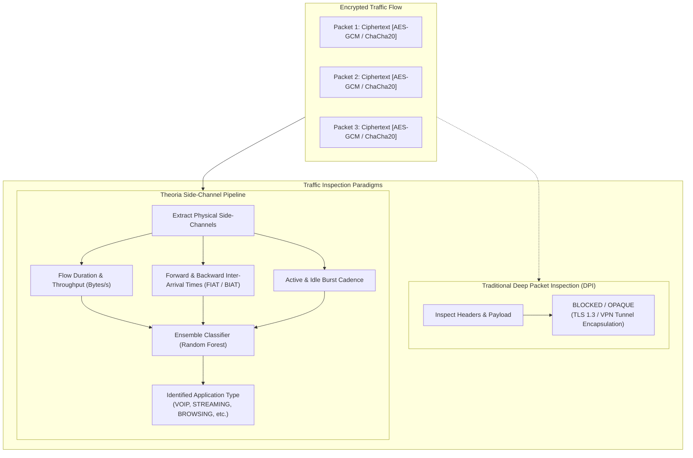
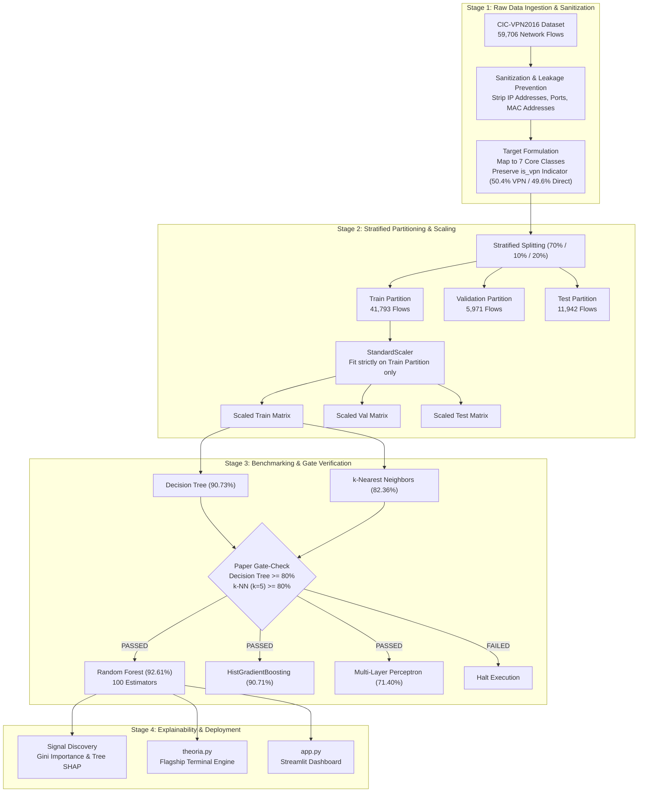
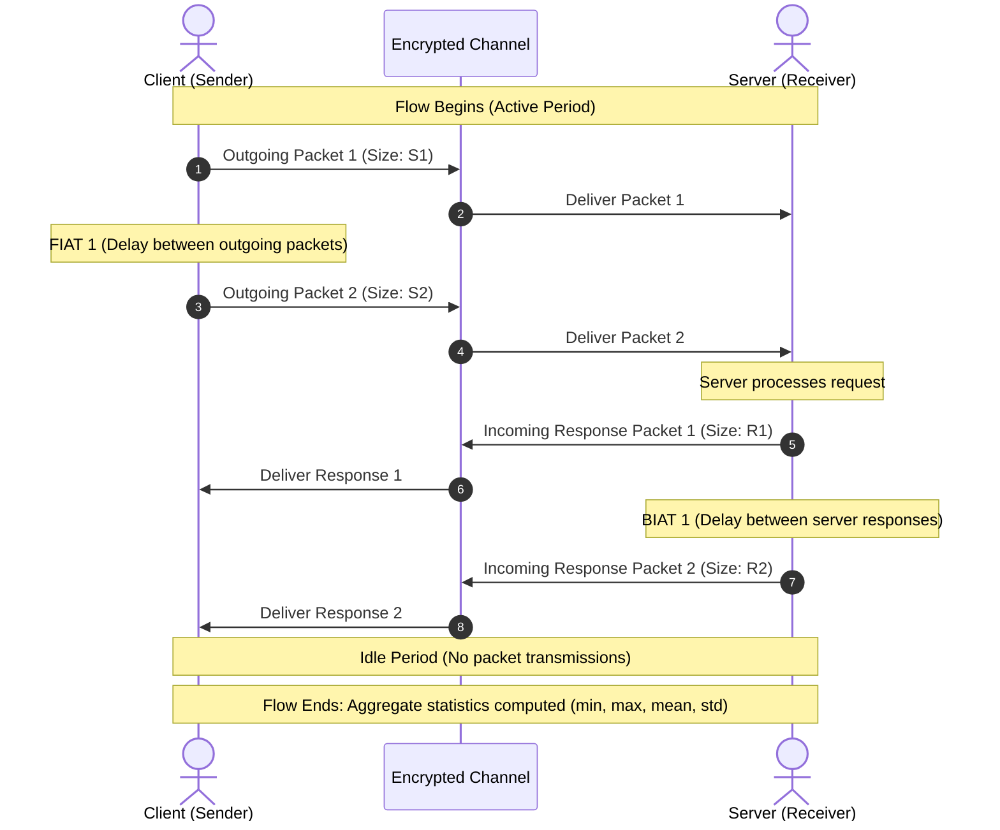
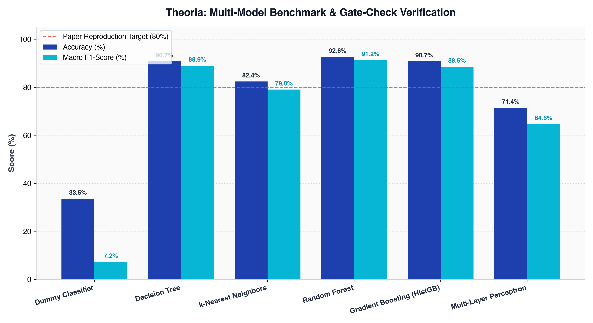
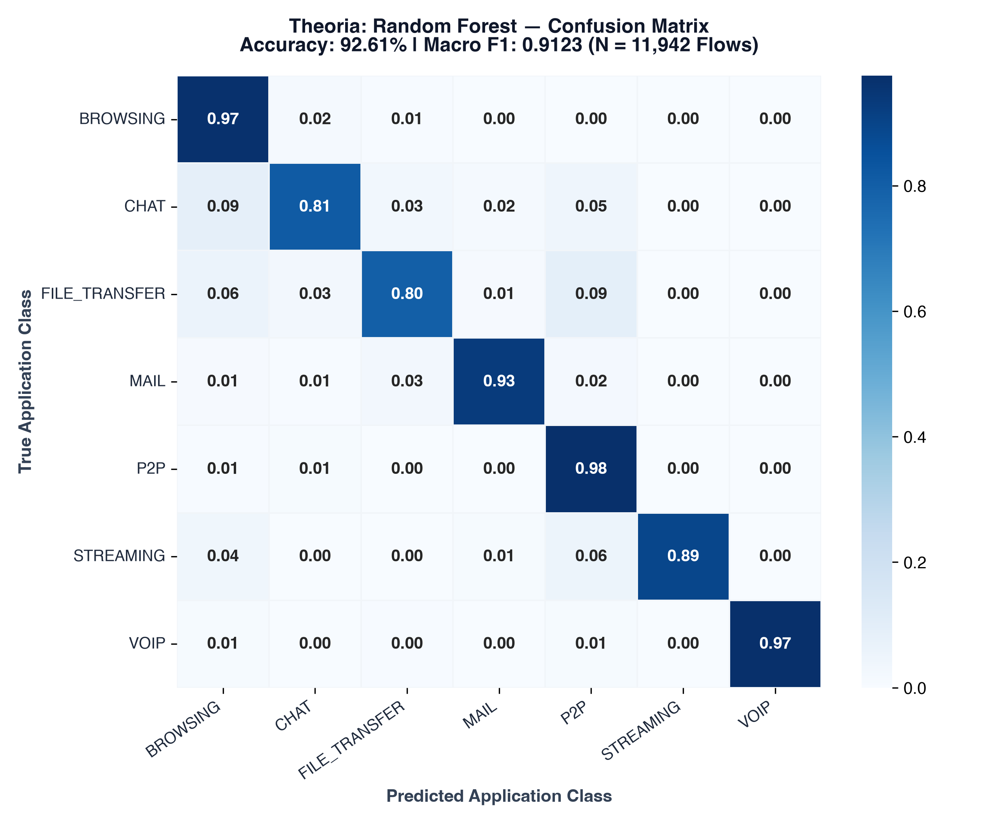
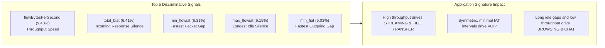
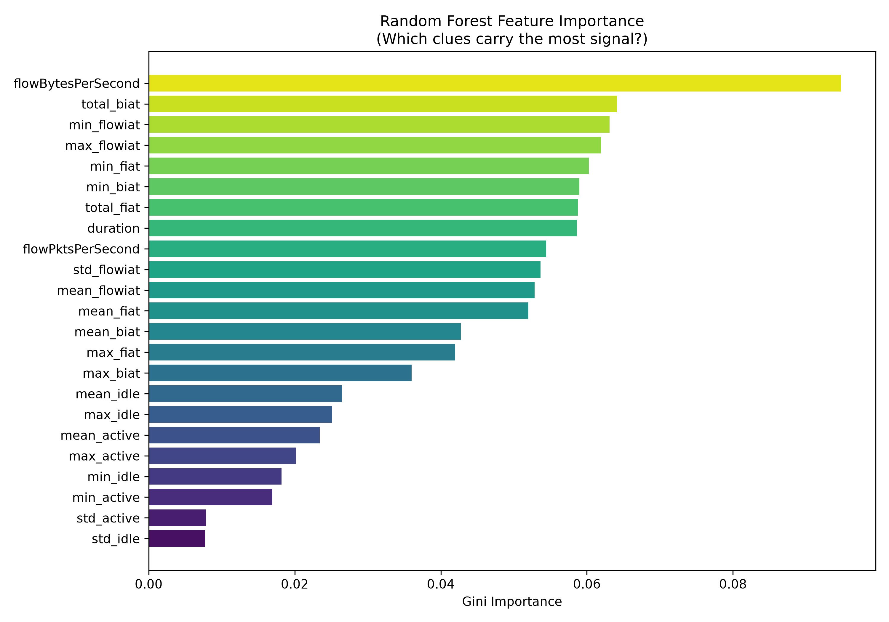
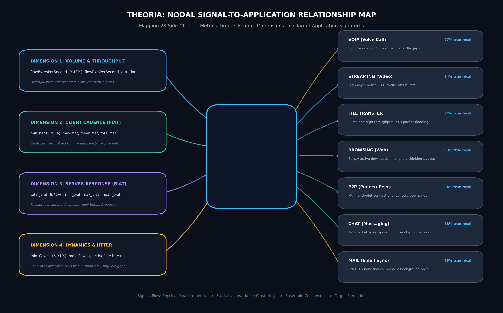
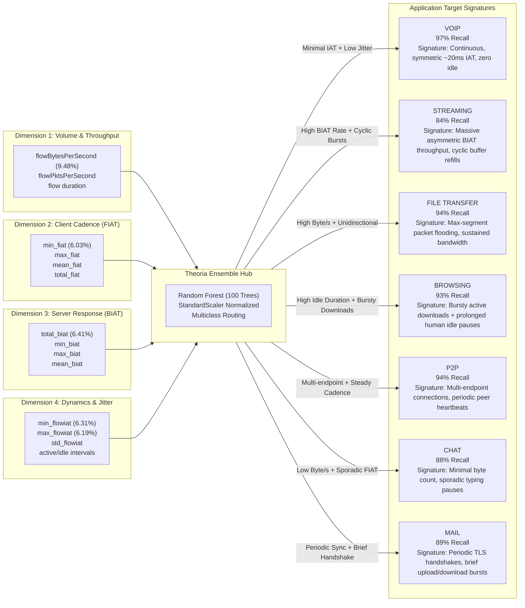
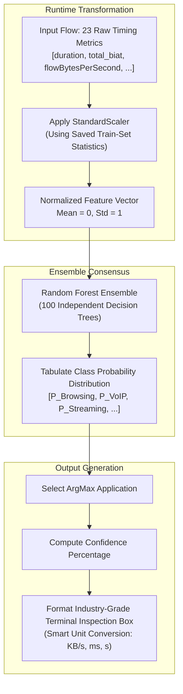

# Theoria: Encrypted Network Traffic Analysis & Classification

<p align="center">
  
  
  
  
  
</p>

> **Core Thesis:** Deep Packet Inspection (DPI) is obsolete in modern TLS 1.3 and VPN-encapsulated internet architecture. **Theoria** demonstrates that machine learning models can accurately identify the application running inside an encrypted network conversation using **only external side-channel metadata** (packet timing, byte rates, and idle pauses) — without cracking encryption or reading sensitive user data.

---

## The Sealed Parcel Metaphor & Threat Model

Traditional network monitoring relies on reading packet contents or inspecting port numbers. Encryption (HTTPS, TLS 1.3, VPN) eliminates this capability by scrambling the packet payload and tunneling connections.

Theoria operates under the **Sealed Parcel** paradigm: treating each encrypted network flow as a sealed courier delivery where the inspector cannot open the box, but can observe physical dimensions, weight, cadence of arrivals, and rattle.



---

## End-to-End System Architecture

Theoria enforces strict data hygiene to avoid data leakage and premature optimization. The complete system follows a staged, gate-checked pipeline:



---

## Network Flow Timing Dynamics (FIAT vs. BIAT)

Network flows are characterized by directional timing gaps. The sequence diagram below illustrates how forward inter-arrival time (FIAT) and backward inter-arrival time (BIAT) capture the conversational rhythm without decrypting content:



Different applications manifest distinct timing signatures in this sequence:
* **VoIP:** Continuous, symmetric transmissions with minute, regular FIAT and BIAT values (~20ms jitter-free cadence).
* **Streaming:** Massive asymmetric BIAT throughput (server-to-client bursts) followed by steady buffer-refill intervals.
* **File Transfer:** Maximum segment size packet flooding with near-zero FIAT/BIAT until transfer completion.
* **Browsing:** Highly bursty active download intervals followed by protracted, irregular human idle times.

---

## Benchmark Leaderboard

Evaluated on **11,942 unseen test flows** using both Accuracy and Macro F1:

| Model | Accuracy | Macro F1 | Weighted F1 | Research Role & Verdict |
| :--- | :---: | :---: | :---: | :--- |
| **Random Forest** | **92.61%** | **0.9123** | **0.9254** | **Ensemble Champion** (Top performer across all 7 classes) |
| **Decision Tree** | **90.73%** | **0.8893** | **0.9067** | **Paper Baseline 1** (Gate Check Passed: Target >= 80%) |
| **Gradient Boosting (HistGB)** | **90.71%** | **0.8849** | **0.9059** | Histogram-based boosted decision trees |
| **k-Nearest Neighbors ($k=5$)** | **82.36%** | **0.7898** | **0.8216** | **Paper Baseline 2** (Gate Check Passed: Target >= 80%) |
| **Multi-Layer Perceptron (MLP)** | **71.40%** | **0.6460** | **0.7027** | Neural network baseline (struggles on tabular statistics) |
| **Dummy Classifier** | **33.50%** | **0.0717** | **0.1681** | Sanity floor (Predicts majority class: Browsing) |

<p align="center">
  
</p>

### Confusion Matrix (Random Forest Champion)

The normalized confusion matrix demonstrates clean diagonal separation across all application types, confirming that minority classes like Streaming and Chat are identified with high precision:

<p align="center">
  
</p>

---

## Signal Discovery: What Makes the Box Rattle?

To identify which side-channel measurements carry the strongest discriminatory signal, we evaluated both tree-based Gini importance and SHAP (SHapley Additive exPlanations) values on a stratified 2,000-sample test subset:



| Rank | Feature Name | Importance | Physical Meaning |
| :---: | :--- | :---: | :--- |
| **#1** | `flowBytesPerSecond` | **9.48%** | Data transfer rate: bulk data vs. lightweight interactive messaging |
| **#2** | `total_biat` | **6.41%** | Total incoming packet pause duration: server transmission activity |
| **#3** | `min_flowiat` | **6.31%** | Shortest pause between any two packets: application heartbeat regularity |
| **#4** | `max_flowiat` | **6.19%** | Longest silence period: user think time and idle intervals |
| **#5** | `min_fiat` | **6.03%** | Shortest pause between outgoing packets: client upload frequency |

<p align="center">
  
</p>

---

## Nodal Signal-to-Application Routing Map

The 23 numerical features do not act in isolation. Rather, they group into **4 Functional Feature Dimensions** that converge into the Theoria Ensemble Hub, where non-linear decision thresholds route distinct physical signatures directly into target application classifications:

<p align="center">
  
</p>



### Logical Explanation of Nodal Routing:
1. **VoIP Routing:** Governed by **Dimension 4 (Dynamics & Jitter)** and **Dimension 2/3 (FIAT/BIAT)**. Audio codecs emit frames at fixed 20ms intervals. Regardless of VPN tunneling or TLS wrapping, packets must depart continuously without buffering delay. The classifier recognizes VoIP by near-zero variance in `min_flowiat` and low `flowBytesPerSecond`.
2. **Streaming Routing:** Governed by **Dimension 1 (Volume & Throughput)** and **Dimension 3 (Server BIAT)**. Video players rapidly pull chunks of content to refill the client buffer, creating massive asymmetric bursts from server to client (`mean_biat`), followed by predictable silent pauses while the user watches buffered video.
3. **File Transfer Routing:** Governed by **Dimension 1 (Volume & Throughput)**. Characterized by maximum transmission unit (MTU) packet flooding in one direction with sustained saturation of `flowBytesPerSecond`.
4. **Browsing Routing:** Governed by **Dimension 4 (Idle Intervals)**. Human web interactions are inherently bursty: requesting a web page triggers a flurry of TCP/TLS handshakes and asset downloads (active period), followed by hundreds of seconds of silence while the human reads the page (`max_idle` and `max_flowiat`).
5. **P2P & Background Sync (Chat/Mail):** Characterized by periodic keep-alive probes and intermittent, lightweight payloads.

---

## Runtime Inference Execution Workflow

When an unknown network conversation is analyzed at runtime, `theoria.py` executes the following deterministic workflow:



---

## Glossary of Technical Terms

| Term | Plain-English Definition | Role in Theoria |
| :--- | :--- | :--- |
| **Network Flow** | A complete bidirectional series of packets between two internet endpoints sharing the same protocol and addressing. | The fundamental unit of analysis. Each dataset row represents one flow. |
| **Inter-Arrival Time (IAT)** | The time duration elapsed between the arrival of one packet and the next packet in the same flow. | Primary side-channel fingerprint: separates steady streaming from bursty web activity. |
| **FIAT / BIAT** | **Forward IAT:** Pauses between client-to-server packets.<br>**Backward IAT:** Pauses between server-to-client packets. | Identifies directional imbalance (e.g., upload vs. download dominance). |
| **Side-Channel Metadata** | Observable physical properties (timing, sizes, rates) emitted as a byproduct of encrypted communication. | The sole data source evaluated by Theoria, guaranteeing zero payload inspection. |
| **StandardScaler** | Normalization method scaling features to have zero mean and unit variance: $z = (x - \mu) / \sigma$. | Equalizes scale differences between massive byte rates and sub-millisecond timings. |
| **Stratified Splitting** | Partitioning data such that the target class proportions are preserved identically across subsets. | Prevents rare classes (`STREAMING` at 4.0%) from being under-sampled in test splits. |
| **Gini Importance** | Mean decrease in node impurity accumulated across all trees in a random forest. | Quantifies which of the 23 features contribute most to resolving classes. |
| **SHAP (Shapley Values)** | Cooperative game-theoretic measure allocating credit to each feature for a single prediction. | Explains the directional influence of individual feature values per application class. |
| **Macro F1-Score** | Unweighted arithmetic mean of F1-scores across all individual classes: $\frac{1}{N} \sum_{i=1}^N F1_i$. | Eliminates class imbalance bias to prove uniform classification fidelity. |

---

## Quickstart & Installation

### 1. Prerequisites & Environment Setup
Clone the repository and set up a virtual environment:

```bash
git clone https://github.com/OjasSingh1o1/Theoria.git
cd Theoria

python3 -m venv venv
source venv/bin/activate
pip install -r requirements.txt
```

### 2. Flagship Terminal Engine
Run the primary terminal demonstration with system telemetry, benchmark tables, signal rankings, and live mystery parcel testing:

```bash
./venv/bin/python theoria.py
```

### 3. Pipeline Health & Verification
Verify artifact integrity, model serialization, and live prediction sanity:

```bash
./venv/bin/python src/verify_pipeline.py
```

### 4. Interactive Web Dashboard
Launch the interactive Streamlit user interface:

```bash
./venv/bin/python -m streamlit run app.py
```

---

## Repository Structure

```
Theoria/
├── README.md                       # Comprehensive system architecture & documentation
├── theoria.py                      # Flagship terminal engine and live inspector
├── app.py                          # Streamlit web visualization dashboard
├── requirements.txt                # Pinned production dependencies
├── consolidated_traffic_data.csv   # Unzipped raw dataset (59,706 rows x 24 columns)
├── data/
│   └── prepared_data.npz           # Cleaned & scaled Train/Val/Test partitions
├── models/                         # Serialized model weights and transformers
│   ├── scaler.pkl                  # Fitted StandardScaler
│   ├── label_encoder.pkl           # 7-Class LabelEncoder
│   ├── dummy_classifier.pkl        # Sanity floor baseline
│   ├── decision_tree.pkl           # Paper baseline 1 (Gate check)
│   ├── k-nearest_neighbors.pkl     # Paper baseline 2 (Gate check)
│   ├── random_forest.pkl           # Ensemble champion (92.61%)
│   ├── gradient_boosting_(histgb).pkl # Boosted decision trees
│   └── multi-layer_perceptron.pkl  # Neural network baseline
├── results/                        # Confusion matrices and SHAP explainability plots
│   ├── model_comparison.json       # Benchmark metrics across all models
│   ├── random_forest_confusion_matrix.png
│   ├── feature_importance_ranking.png
│   ├── shap_global_bar.png
│   ├── shap_voip_dot.png
│   ├── shap_streaming_dot.png
│   ├── shap_file_transfer_dot.png
│   └── shap_values.npz             # Computed raw SHAP value matrices
└── src/
    ├── preprocessing.py            # Data hygiene & stratified splitting
    ├── train.py                    # Multi-model benchmarking pipeline
    ├── explainability.py          # Gini importance and SHAP computation
    └── verify_pipeline.py          # End-to-end system verification suite
```

---

## Ethics & Privacy

Theoria operates strictly on aggregate statistical metrics (packet counts, timing intervals, and byte volumes). The system never captures raw packet payloads, never attempts cryptographic key reconstruction, and explicitly excludes addressing identifiers (MAC addresses, IP addresses, and TCP/UDP port numbers). This project demonstrates that cryptographic encapsulation alone does not eliminate information leakage, underscoring the necessity of timing padding and traffic morphing in privacy-conscious protocol design.
