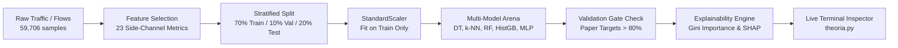

# 📦 Theoria: Encrypted Network Traffic Analysis & Classification

<p align="center">
  
  
  
  
  
</p>

> **Core Thesis:** Deep Packet Inspection (DPI) is obsolete in modern TLS 1.3 and VPN-encapsulated internet architecture. **Theoria** demonstrates that machine learning models can accurately identify the application running inside an encrypted network conversation using **only external side-channel metadata** (packet timing, byte rates, and idle pauses) — without cracking encryption or reading sensitive user data.

---

## 🎯 The Sealed Parcel Metaphor

```
       [ Encrypted Internet Traffic / VPN Tunnel ]
                     │
                     ▼
      ┌─────────────────────────────────┐
      │   📦 THE SEALED PARCEL          │
      │   • Cannot open the lid         │
      │   • Cannot read contents        │
      │   • IP & Port addresses hidden  │
      └─────────────────────────────────┘
                     │
       Physical Clues Outside the Box:
       ├── ⚖️ How heavy is it?         ➜ Packet sizes & transfer rate (KB/s)
       ├── ⏱️ When do packages drop?    ➜ Packet Inter-Arrival Times (IAT)
       ├── 🎵 Does it rattle / rhythm? ➜ Timing jitter & idle intervals
       └── ⏳ Conversation length      ➜ Total active flow duration
                     │
                     ▼
      ┌─────────────────────────────────┐
      │   🔮 THEORIA CLASSIFIER         │
      │   "This pattern is a VOIP Call" │
      └─────────────────────────────────┘
```

---

## ⚙️ End-to-End System Architecture

Theoria processes network flows through a strict, leak-free pipeline:



### Breakdown of Stages:
1. **Zero-Leakage Ingestion:** Features that could cause memorization shortcuts (IP addresses, port numbers, MAC addresses) are eliminated. The model only learns pure traffic physics.
2. **Stratified Partitions:** Partitions (41,793 train / 5,971 val / 11,942 test) preserve both the 7-class distribution and the 50.4% VPN encapsulation balance.
3. **Strict Scaler Hygiene:** `StandardScaler` is fitted *strictly* on the training set to prevent future test-set statistics from leaking backward.
4. **Research Gate-Check:** Replicates original paper baselines (Decision Tree & k-NN) past 80% accuracy before admitting advanced ensemble models into benchmarking.

---

## 🏆 Benchmark Leaderboard

Evaluated strictly on **11,942 unseen test flows**:

| Model | Accuracy | Macro F1 | Weighted F1 | Research Role & Verdict |
| :--- | :---: | :---: | :---: | :--- |
| **Random Forest** 🏆 | **92.61%** | **0.9123** | **0.9254** | **Ensemble Champion** (Best generalizer) |
| **Decision Tree** | **90.73%** | **0.8893** | **0.9067** | **Paper Baseline 1** (Gate Passed: Target > 80%) |
| **Gradient Boosting (HistGB)** | **90.71%** | **0.8849** | **0.9059** | Histogram-based boosted decision trees |
| **k-Nearest Neighbors ($k=5$)** | **82.36%** | **0.7898** | **0.8216** | **Paper Baseline 2** (Gate Passed: Target > 80%) |
| **Multi-Layer Perceptron (MLP)** | **71.40%** | **0.6460** | **0.7027** | Neural network baseline |
| **Dummy Classifier** | **33.50%** | **0.0717** | **0.1681** | Sanity floor (Always predicts `BROWSING`) |

> [!NOTE]
> **Why Macro F1 Matters:** Because classes range from 20,000 (`BROWSING`) to 2,399 (`STREAMING`), accuracy alone is deceptive. The 0.9123 Macro F1 proves Theoria achieves high precision and recall on minority classes, not just the majority class.

---

## 🔬 Signal Discovery: What Makes the Box Rattle?

Using Gini Feature Importance and **SHAP (SHapley Additive exPlanations)** on a 2,000-sample stratified test subset, we identified which physical clues carry the signal:

| Rank | Feature | Importance | What It Measures |
| :---: | :--- | :---: | :--- |
| **#1** | `flowBytesPerSecond` | **9.48%** | **Data transfer rate:** Distinguishes heavy downloads from text messages. |
| **#2** | `total_biat` | **6.41%** | **Total incoming pause duration:** How long server packet responses pause. |
| **#3** | `min_flowiat` | **6.31%** | **Minimum packet pause:** The fastest heartbeat between packets. |
| **#4** | `max_flowiat` | **6.19%** | **Maximum packet pause:** Extended silence periods (user idle time). |
| **#5** | `min_fiat` | **6.03%** | **Minimum outgoing pause:** Cadence of packets sent out by user client. |

### Visual Explainability Artifacts:
* `results/feature_importance_ranking.png`: Global Gini power rankings.
* `results/shap_global_bar.png`: Global SHAP magnitude across all 7 classes.
* `results/shap_voip_dot.png`: Tiny, continuous packet gaps characterize VoIP calls.
* `results/shap_streaming_dot.png`: Sustained high throughput characterizes video streams.
* `results/shap_file_transfer_dot.png`: Unidirectional bulk packet bursts identify file transfers.

---

## 📖 Glossary of Technical Terms

| Term | Plain-English Definition | Role in Theoria |
| :--- | :--- | :--- |
| **Network Flow** | A complete bidirectional conversation between two internet endpoints from start to finish. | The basic unit of data. Each row in our dataset represents 1 complete flow. |
| **Inter-Arrival Time (IAT)** | The time gap (pause) measured in milliseconds or seconds between two consecutive packets. | Distinguishes regular heartbeats (VoIP) from irregular bursty traffic (Web Browsing). |
| **FIAT / BIAT** | **Forward IAT:** Pauses between outgoing packets.<br>**Backward IAT:** Pauses between incoming response packets. | Separates upload-heavy patterns from download-heavy patterns. |
| **Side-Channel Metadata** | Observable physical properties (timing, size, rate) that leak outside an encrypted channel. | The only data Theoria uses to classify traffic, avoiding payload decryption. |
| **StandardScaler** | Transforms numerical features to have a mean of 0 and a standard deviation of 1. | Prevents high-magnitude metrics (like byte counts) from dominating microsecond timings. |
| **Stratified Splitting** | Dividing data such that every subset contains the identical class proportions as the full set. | Ensures minority classes like Streaming and Mail are fairly represented in train and test splits. |
| **Gini Importance** | A measure of how much a feature improves tree node purity across the Random Forest. | Highlights which network metrics carry the strongest discriminative power. |
| **SHAP Values** | Game-theory metric measuring how much a specific feature value pushes a prediction toward or away from a class. | Explains the underlying *reasoning* behind the classifier's predictions. |
| **Macro F1-Score** | The unweighted average of F1-scores calculated across all classes independently. | The true yardstick for imbalanced multi-class evaluation. |

---

## 🚀 Quickstart & Usage

### 1. Installation
Clone the repository and set up the virtual environment:

```bash
git clone https://github.com/OjasSingh1o1/Theoria.git
cd Theoria

# Initialize virtual environment
python3 -m venv venv
source venv/bin/activate

# Install dependencies
pip install -r requirements.txt
```

### 2. Run the Flagship Terminal Engine
Launch the interactive terminal interface:

```bash
./venv/bin/python theoria.py
```

### 3. Run Pipeline Verification Suite
Run end-to-end health check across all models, datasets, and serialization files:

```bash
./venv/bin/python src/verify_pipeline.py
```

### 4. Interactive Web Dashboard
Run the Streamlit live demonstration interface:

```bash
./venv/bin/python -m streamlit run app.py
```

---

## 📁 Repository Directory Structure

```
Theoria/
├── README.md                       # Complete technical guide & architecture (this file)
├── theoria.py                      # Flagship terminal engine & interactive inspector
├── app.py                          # Streamlit web visualization dashboard
├── requirements.txt                # Pinned dependencies
├── consolidated_traffic_data.csv   # Dataset (59,706 flows x 24 columns)
├── data/
│   └── prepared_data.npz           # Cleaned & scaled Train/Val/Test partitions
├── models/                         # Serialized models and transformers
│   ├── scaler.pkl                  # Fitted StandardScaler
│   ├── label_encoder.pkl           # 7-Class LabelEncoder
│   ├── dummy_classifier.pkl        # Sanity floor baseline
│   ├── decision_tree.pkl           # Paper baseline 1 (Gate check)
│   ├── k-nearest_neighbors.pkl     # Paper baseline 2 (Gate check)
│   ├── random_forest.pkl           # Ensemble champion (92.61%)
│   ├── gradient_boosting_(histgb).pkl # Boosted decision trees
│   └── multi-layer_perceptron.pkl  # Neural network baseline
├── results/                        # Confusion matrices and SHAP explainability plots
│   ├── model_comparison.json
│   ├── random_forest_confusion_matrix.png
│   ├── feature_importance_ranking.png
│   ├── shap_global_bar.png
│   ├── shap_voip_dot.png
│   ├── shap_streaming_dot.png
│   ├── shap_file_transfer_dot.png
│   └── shap_values.npz
└── src/
    ├── preprocessing.py            # Data hygiene & stratified splitting
    ├── train.py                    # Multi-model training and benchmarking
    ├── explainability.py          # Gini and SHAP computation
    └── verify_pipeline.py          # End-to-end integrity test
```

---

## ⚖️ Ethics & Privacy
Theoria inspects **only aggregate timing and sizing statistics**. It does not perform packet interception, does not decrypt payloads, and ignores hardware/network identifiers (IP/MAC/Ports). It serves as academic proof that network security architectures must consider side-channel leakage when designing privacy-preserving protocols.
